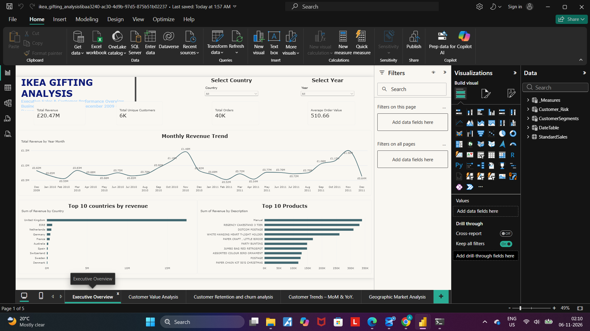
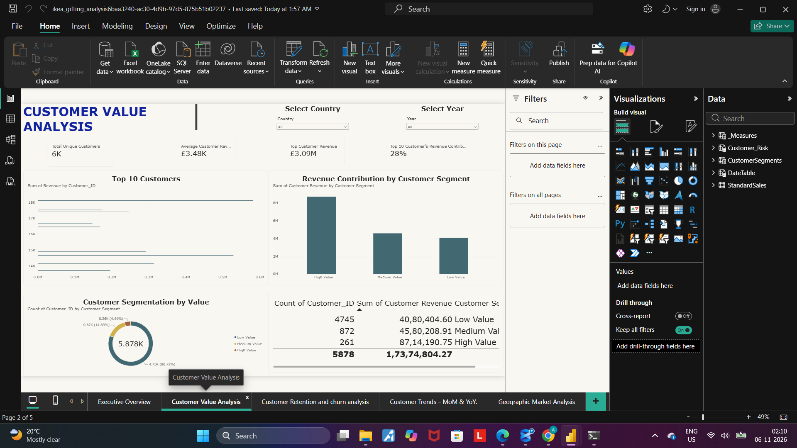
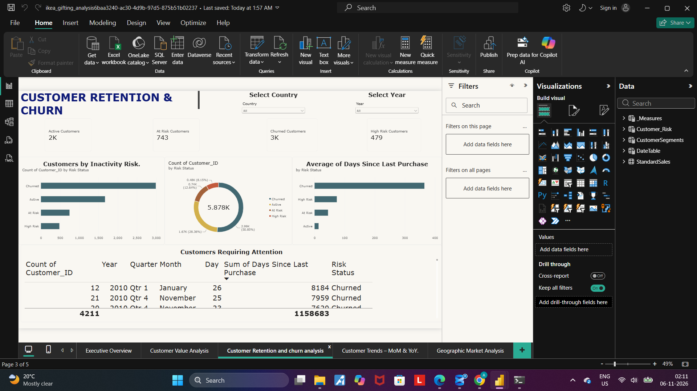
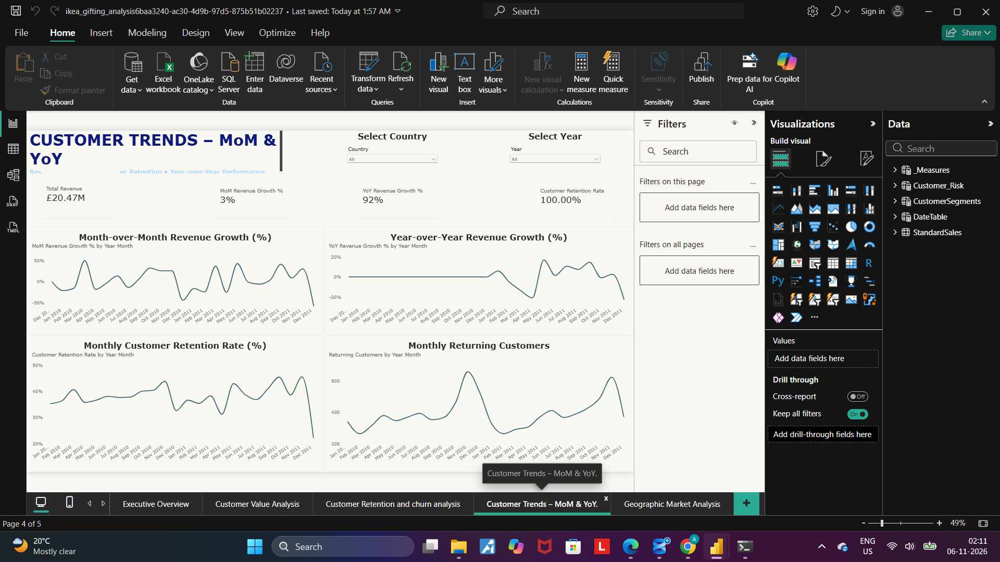
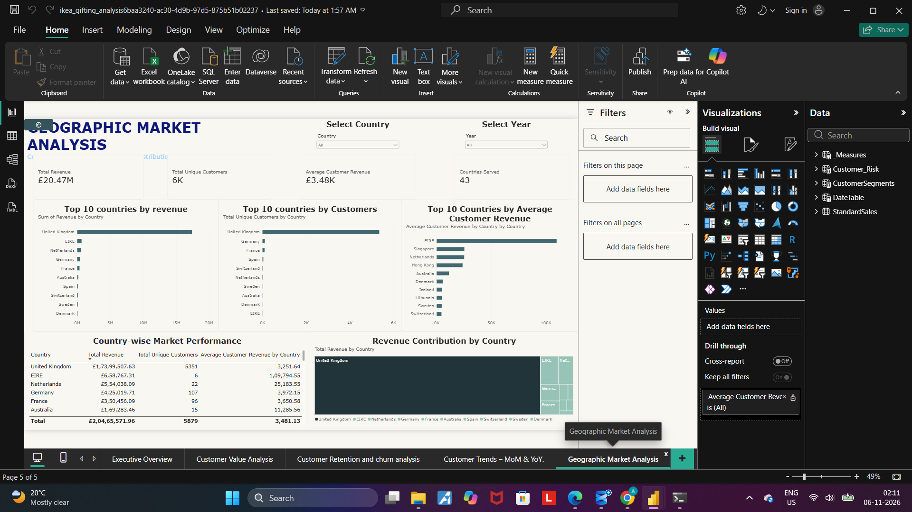

# IKEA Gifting Analysis

### Retail Data Analysis | Python | SQL Server | Power BI | DAX

## 1. Project Overview

IKEA Gifting Analysis is an end-to-end data analytics portfolio project focused on analyzing retail transaction data to uncover meaningful business insights related to sales performance, customer purchasing behavior, customer value, retention, churn risk, and geographic market performance.

The project follows a practical data analytics workflow, starting with raw data extraction and cleaning using Python, followed by data storage and querying in Microsoft SQL Server, and finally interactive dashboard development using Power BI.

The primary objective is to transform raw transactional data into meaningful insights that can support business decision-making, identify customer opportunities, and improve understanding of retail performance.

**Dataset clarification:** The project uses the Online Retail II dataset. IKEA Gifting Analysis is the project title and branding, not the original source of the dataset.

## 2. Business Problems Addressed

The analysis focuses on answering the following business questions:

1. **Sales Performance:** How is the business performing in terms of revenue, orders, and average order value?
2. **Customer Value:** Who are the most valuable customers, and how much revenue do they contribute?
3. **Customer Retention:** Which customers are returning, and how does customer retention change over time?
4. **Churn Risk:** Which customers have stopped purchasing or may be at risk of becoming inactive?
5. **Sales Trends:** How are monthly and yearly revenue trends changing?
6. **Product Performance:** Which products generate the highest revenue?
7. **Geographic Performance:** Which countries contribute the most revenue and customers?
8. **Market Opportunities:** Which geographic markets show stronger customer value and revenue potential?

## 3. Technology Stack

| Technology | Purpose |
|---|---|
| Python | Data cleaning and preprocessing |
| Pandas | Data manipulation and analysis |
| NumPy | Numerical operations |
| Jupyter Notebook | Python development environment |
| Microsoft SQL Server | Data storage and querying |
| SQL | Structured data analysis |
| Power BI | Interactive dashboards |
| DAX | Measures and business calculations |
| Git & GitHub | Version control and project documentation |

## 4. Project Workflow

### Phase 1: Data Loading and Exploration — Python

- Imported the two parts of the Online Retail II dataset.
- Loaded and combined the datasets using Pandas.
- Explored the dataset structure, data types, missing values, and duplicate records.
- Examined transaction dates, product descriptions, customer IDs, quantities, and prices.
- Identified data quality issues before beginning the cleaning process.

### Phase 2: Data Cleaning and Preprocessing — Python

Used Pandas and NumPy to prepare the dataset for analysis.

Key operations included:

- Removing duplicate transaction records.
- Handling missing product descriptions.
- Identifying and handling missing customer IDs.
- Identifying cancelled invoices and negative quantities.
- Handling zero-price and invalid transactions.
- Converting transaction dates into appropriate datetime formats.
- Creating calculated revenue fields.
- Preparing separate datasets for different stages of analysis.
- Exporting cleaned datasets into CSV files.

### Phase 3: Database Management — SQL Server

- Created a dedicated SQL Server database for the project.
- Imported the cleaned sales dataset into SQL Server.
- Structured the data into an analysis-ready table.
- Used SQL to query and examine sales and customer information.
- Prepared the processed data for Power BI reporting.

### Phase 4: Data Modeling and Dashboard Development — Power BI

- Connected Power BI to the SQL Server database.
- Created a date table for time-based analysis.
- Established relationships between the date table and sales data.
- Developed DAX measures for revenue, orders, customer metrics, growth, and retention.
- Created customer risk and segmentation classifications.
- Built interactive dashboards with date and country filters.

## 5. Dashboard Structure

The final Power BI report contains five analytical pages.

### Page 1 — Executive Overview

Provides a high-level summary of business performance.

Key metrics and visuals:
- Total Revenue
- Total Unique Customers
- Total Orders
- Average Order Value
- Monthly Revenue Trend
- Top 10 Products by Revenue
- Top 10 Countries by Revenue

### Page 2 — Customer Value Analysis

Focuses on identifying valuable customers and understanding their contribution to revenue.

Key analysis:
- Top 10 Customers by Revenue
- Average Customer Revenue
- Top Customer Revenue
- Top 10 Customer Revenue Contribution
- Customer Segmentation
- High-, Medium-, and Low-Value Customer Analysis

Customer segmentation uses project-defined revenue thresholds.

### Page 3 — Customer Retention & Churn

Analyzes customer inactivity and potential churn risk.

Key analysis:
- Active Customers
- At-Risk Customers
- High-Risk Customers
- Churned Customers
- Customer Risk Distribution
- Customers Requiring Attention
- Last Purchase Date
- Days Since Last Purchase

Customer risk classification is based on the number of days since the last recorded purchase:
- 0–30 days: Active
- 31–60 days: At Risk
- 61–90 days: High Risk
- More than 90 days: Churned

These are analytical thresholds defined for this project, not official business classifications.

### Page 4 — Customer Trends & Performance

Examines revenue growth and customer behavior over time.

Key analysis:
- Month-over-Month Revenue Growth
- Year-over-Year Revenue Growth
- Monthly Returning Customers
- Monthly Customer Retention Rate
- Revenue Trend Analysis

### Page 5 — Geographic Market Analysis

Evaluates business performance across different countries.

Key analysis:
- Top 10 Countries by Revenue
- Top 10 Countries by Customer Base
- Top 10 Countries by Average Customer Revenue
- Revenue Contribution by Country
- Country-wise Market Performance
- Geographic Customer Distribution

## 6. Technical Challenges Faced and Solutions

Working with a large, real-world transactional dataset introduced several data quality, database, and visualization challenges.

### Challenge 1: Handling a Large Dataset

**Problem:** The original dataset contained more than one million transaction records, making it important to combine and process the data carefully.

**Solution:**
- Loaded the two CSV files using Pandas.
- Combined them into one dataset.
- Inspected the resulting structure and dimensions.
- Used Pandas operations to clean and prepare the data systematically.

### Challenge 2: Duplicate Transactions

**Problem:** The original dataset contained duplicate records that could affect revenue calculations and transaction analysis.

**Solution:**
- Identified duplicate rows using Pandas.
- Removed 34,335 duplicate records.
- Rechecked the dataset to ensure duplicate records were removed.

### Challenge 3: Missing Customer Information

**Problem:** A significant number of transactions had missing Customer IDs, making customer-level analysis unreliable for those records.

**Solution:**
- Identified missing Customer IDs.
- Avoided inventing customer identities or assigning arbitrary IDs.
- Excluded records without valid customer identification from customer-specific calculations where appropriate.
- Preserved the distinction between transaction-level and customer-level analysis.

### Challenge 4: Cancelled and Invalid Transactions

**Problem:** The dataset contained cancelled invoices, negative quantities, zero-price transactions, and other records that could distort normal sales analysis.

**Solution:**
- Identified cancellation transactions and negative quantities.
- Examined zero-price and invalid records.
- Separated standard sales transactions from records that should not contribute to normal sales calculations.
- Prepared a dedicated standard-sales dataset for business analysis.

### Challenge 5: Date and Time Formatting

**Problem:** Transaction dates were initially stored as text, making time-based analysis difficult.

**Solution:**
- Converted transaction dates into proper datetime values using Pandas.
- Created a date-only field for Power BI relationships.
- Built a dedicated DateTable with year, month, and year-month attributes.
- Established an active one-to-many relationship between the DateTable and sales data.

### Challenge 6: SQL Server Data Import Error

**Problem:** During SQL Server import, Customer_ID values such as 17850.0 caused conversion errors because the column was being treated as an integer.

**Solution:**
- Investigated the source data type.
- Identified the mismatch between the imported value format and the SQL column type.
- Corrected the data type handling to support the imported customer identifiers.

### Challenge 7: Incorrect Month Ordering in Power BI

**Problem:** Month names were appearing alphabetically instead of chronologically in the monthly revenue visual.

**Solution:**
- Created a numeric Year-Month Sort column.
- Used Power BI's Sort by Column functionality.
- Sorted the Year Month field using the numeric sort column to display months in chronological order.

### Challenge 8: Complex DAX Calculations

**Problem:** Customer revenue contribution, customer risk classification, retention, and growth calculations required more than basic aggregations.

**Solution:**
- Developed reusable DAX measures.
- Used functions such as CALCULATE, DIVIDE, SUMX, TOPN, INTERSECT, DATEADD, and SWITCH.
- Created calculated tables for customer segmentation and risk classification.
- Validated calculations through Power BI visuals and filter contexts.

## 7. Key Analytical Concepts Implemented

- Data Cleaning and Preprocessing
- Exploratory Data Analysis
- Data Transformation
- Relational Database Management
- SQL Querying
- Data Modeling
- DAX Measures
- Customer Segmentation
- Customer Retention Analysis
- Churn Risk Classification
- Revenue Contribution Analysis
- Month-over-Month Growth
- Year-over-Year Growth
- Geographic Market Analysis
- Interactive Business Intelligence Reporting

## 8. Dataset Information

**Dataset:** Online Retail II

The raw dataset is not included in this repository. It should be obtained from its original source before reproducing the analysis.

The project uses historical retail transaction data for analytical and educational purposes.

## 9. Project Outcome

Developed an end-to-end retail analytics solution that transforms raw transaction data into structured, analysis-ready information and interactive business intelligence dashboards.

The project demonstrates the practical application of Python, SQL, Power BI, and DAX across the data analytics lifecycle, while addressing real-world data quality and analytical challenges.

## 10. Skills Demonstrated

Python | Pandas | NumPy | SQL | Microsoft SQL Server | Data Cleaning | Data Transformation | Data Modeling | DAX | Power BI | Customer Analytics | Business Intelligence | Data Visualization | Git | GitHub

---

**Project Type:** Data Analytics Portfolio Project  
**Author:** Data Analytics Portfolio

## 📊 Dashboard Preview

### 1. Executive Overview

### 2. Customer Value Analysis

### 3. Customer Retention & Churn

### 4. Customer Trends & Performance

### 5. Geographic Market Analysis

